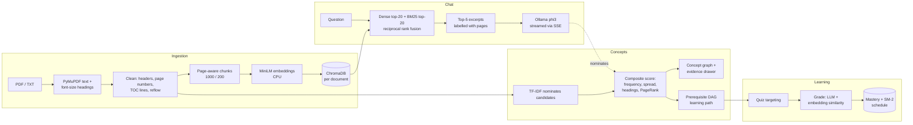

# Visual Document Q&A

📄 **An offline study engine for your documents.** Ask questions and get answers that cite their pages, explore a concept map where every node and link is backed by evidence from the text, follow a prerequisite learning path, and quiz yourself on what you haven't mastered yet. Everything runs locally: FastAPI, ChromaDB, sentence-transformers and Ollama (phi3).


---

## ✨ What makes it different

- **Measured, not generated.** Concept importance is a transparent four-signal score. Click a concept to see its score breakdown, its definition (with page number) and where it appears; click a link to see the exact sentences where two concepts meet.
- **A learning path built from the text.** Concepts are ordered so prerequisites come first, using what each definition relies on and explicit statements like *"X is a type of Y"* or *"X relies on Y"*.
- **It tracks what you know.** Per-concept mastery with spaced repetition (SM-2). Quizzes target important concepts you haven't mastered, wait until you know their prerequisites, and grade your answer against the document.
- **The LLM only nominates.** The local model suggests concepts, but anything it names that isn't in the document is rejected, and every concept is scored by the same measurement engine.
- **Works without the LLM.** If Ollama is down, you still get the concept map, learning path, retrieval with sources, and fill-in-the-blank quizzes graded by exact match.

---

## 🏗️ Architecture



---

## 🚀 Quick Start

### Prerequisites
- Python 3.10+ (tested on 3.14)
- [Ollama](https://ollama.com) with `phi3` pulled (optional, but needed for written answers)

### Setup

```bash
git clone https://github.com/Hemanthraj09/Document-Q-A.git
cd Document-Q-A
python -m venv venv
venv\Scripts\activate            # Windows
# source venv/bin/activate       # macOS / Linux
pip install -r requirements.txt

ollama pull phi3
ollama serve                     # in a separate terminal

uvicorn main:app --reload
```

Open **[http://localhost:8000](http://localhost:8000)**. Copy `.env.example` to `.env` to change any settings.

---

## 🔍 How it works

### Ingestion
PyMuPDF extracts each page's text and tiers headings by font size relative to the body text (H1 > 1.6×, H2 > 1.3×, H3 > 1.15×). The text is cleaned: lines repeated on >30% of pages (running headers and footers), page numbers, dates, URLs and table-of-contents or index lines are removed, and hard-wrapped lines are rejoined. It's then split into 1000-character chunks with 200 characters of overlap, snapped to sentence boundaries, with each chunk tagged with the pages it spans. Chunks are embedded with `all-MiniLM-L6-v2` on the CPU and stored in their own ChromaDB collection. The document record is saved to `data/docs/`, so a restart loses nothing, and uploading the same file again reopens it with your progress.

### Chat
Retrieval is hybrid. The top 20 chunks by embedding similarity and the top 20 by BM25 keyword score are merged with reciprocal rank fusion, and the best 5 go to the model, each labelled with its pages (`[p. 4]`). Lexo answers only from those excerpts and cites them. Each source in the UI shows whether it was a semantic match, a keyword match, or both. Conversation history is trimmed to fit the context window so the system prompt is never truncated.

### Concept engine
TF-IDF over heading-based sections nominates candidate terms. Fragments of longer terms ("descent" inside "gradient descent") are dropped. Each concept is then scored:

```
importance = (0.30 × frequency       TF-IDF, normalised
            + 0.25 × spread          share of sections that mention it
            + 0.20 × heading_weight  H1 = 1.0, H2 = 0.67, H3 = 0.5
            + 0.25 × centrality)     PageRank on the co-occurrence graph
            × multipliers            defined explicitly ×1.3, near a figure/table ×1.2,
                                     worked examples ×1.15, endorsed by the LLM ×2
```

Scores are scaled so the top concept is 100%.

| Tier | Score | Colour |
|------|-------|--------|
| Core | > 0.55 | 🔵 Blue |
| Supporting | 0.30 – 0.55 | 🟡 Yellow |
| Minor | ≤ 0.30 | ⚪ Grey |

### LLM refinement
After the graph renders, a background request sends phi3 a digest of the whole document: the outline plus an excerpt from every section, within 8000 characters. Ollama's JSON mode returns the model's suggested concepts. Suggestions that don't occur in the text are rejected and listed in the UI. Accepted ones are measured like any other concept and get a ×2 endorsement before re-ranking (top 25).

### Learning path
An edge *A → B* ("learn A first") is added when B's definition uses A and A was introduced earlier, when a sentence states the dependency ("B is a type of A", "B relies on A"), or when B is a more specific version of A ("neural network" → "network"). Low-importance concepts never act as prerequisites. Cycles are broken by removing the weakest edge, a transitive reduction removes redundant edges, and a topological sort puts concepts that unlock the most others first. Every edge links to the sentence that justifies it.

### Mastery and quizzes
Each concept tracks mastery (an exponential moving average of quiz scores, mastered at ≥ 80%) and an SM-2 review schedule. The next quiz goes to the concept with the highest *importance × (1 − mastery) × due-for-review × prerequisites-ready*. Questions are written by the LLM from the concept's evidence, with a fill-in-the-blank fallback taken straight from the text when the LLM is unavailable. Free-text answers are graded as 0.6 × LLM judgement + 0.4 × embedding similarity to the reference answer. Asking about a concept in chat marks it as explored.

---

## 📡 API

| Endpoint | Method | Purpose |
|----------|--------|---------|
| `/` | GET | Web UI |
| `/health` | GET | Status, including whether Ollama is reachable |
| `/upload-pdf` | POST | Extract, clean, chunk and index a PDF |
| `/ingest` | POST | Index pasted text or a `.txt` file |
| `/analyze` | POST | Concept graph, learning path and mastery for a document |
| `/analyze-llm` | POST | Background LLM refinement (SSE) |
| `/chat-stream` | POST | Hybrid retrieval and a streamed, cited answer (SSE) |
| `/documents/{id}/concept?term=` | GET | Evidence for one concept |
| `/documents/{id}/relation?a=&b=` | GET | Evidence for a link between two concepts |
| `/documents/{id}/mastery` | GET | Mastery state for every concept |
| `/documents/{id}/quiz` | POST | Next quiz question (optionally for a chosen concept) |
| `/documents/{id}/quiz/{quiz_id}/answer` | POST | Grade an answer and update mastery |

---

## 🧪 Tests

```bash
pytest                      # unit tests: analysis, learning path, mastery, retrieval
python test_endpoints.py    # smoke test against a running server
```

---

## 📁 Project Structure

```
Document-Q-A/
├── main.py            # FastAPI app: endpoints, storage, Ollama calls
├── analysis.py        # Cleaning, sections, sentences, concept-importance engine, LLM merge
├── learning.py        # Evidence lookups and the prerequisite learning path
├── mastery.py         # Mastery tracking, SM-2 scheduling, quiz targeting and grading
├── rag.py             # Page-aware chunking, BM25, rank fusion, chat context
├── index.html         # UI: chat, D3 concept graph, evidence drawer, path, quiz
├── static/            # D3 v7 (served locally so the UI works offline)
├── tests/             # pytest suite
├── test_endpoints.py  # manual smoke test
└── requirements.txt
```

---

## ⚙️ Hardware

Tested on an NVIDIA RTX 4050 Laptop GPU (6 GB VRAM). phi3 (2.2 GB) fits entirely on the GPU at ~12 tokens/s; the embedding model is pinned to the CPU (`EMBED_DEVICE=cpu`) to avoid VRAM contention.

---

## 📝 License

MIT License

## 👤 Author

**Hemanth Raj** — [GitHub](https://github.com/Hemanthraj09)
